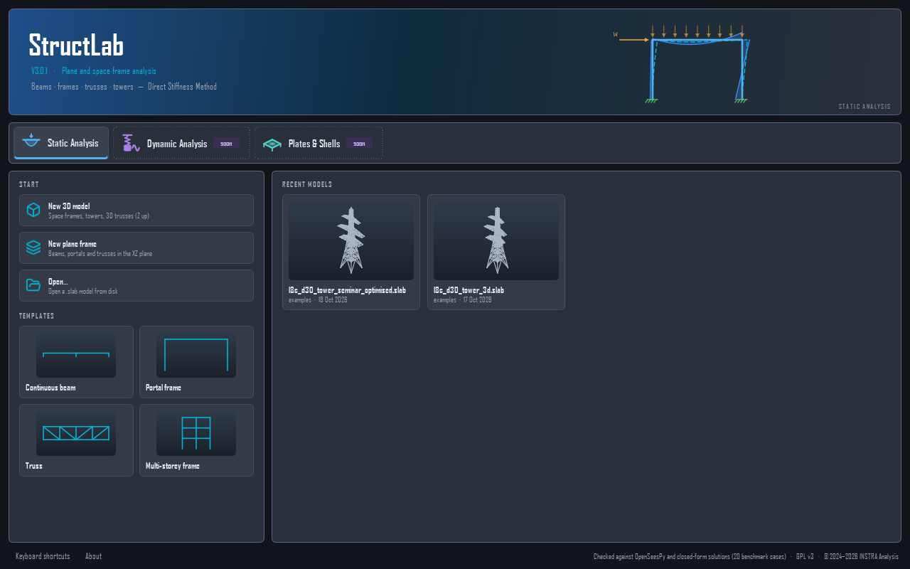
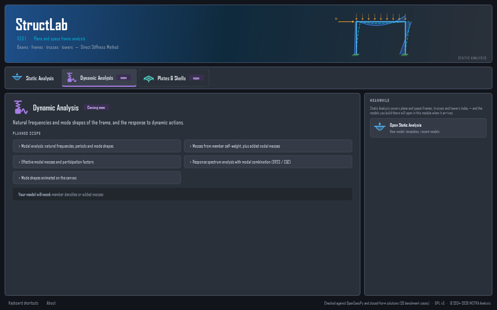

# 1. Getting started

StructLab analyses beams, frames, trusses and towers by the direct stiffness method. Every
model lives in one 3D environment with Z pointing up. A model is either a **space frame**
(six degrees of freedom per node) or a **plane frame** drawn in the XZ plane. The analysis is
linear elastic and first order: displacements, reactions, member forces and diagrams for
each load case and load combination, with member design checks for steel.

## 1.1 Installing StructLab

### Windows build

1. Download `StructLab-V…-windows.zip` from the
   [Releases page](https://github.com/INSTRA-Analysis/StructLabApp/releases/latest).
2. Unzip it anywhere, for example into `Documents`.
3. Run `StructLab\StructLab.exe`.

No Python installation is needed. The build is not code-signed, so Windows SmartScreen may
ask you to confirm the first time (*More info → Run anyway*).

### From the source code

StructLab is written in Python with PyQt6. With Python 3.12 or later:

```bash
pip install -r requirements.txt
python ui_qt/main.py
```

## 1.2 The start page

The start page opens when StructLab starts, and again from **File → New** (Ctrl+N).



The banner at the top shows the version. Below it, one tab per analysis module:

| Tab | What it holds |
|---|---|
| **Static Analysis** | Everything StructLab does today: new models, templates, recent models |
| **Dynamic Analysis** | Coming soon: modal and response spectrum analysis |
| **Plates & Shells** | Coming soon: finite-element plates and shells |

On the **Static Analysis** tab:

- **New 3D model** starts an empty space frame: towers, space trusses, 3D frames.
- **New plane frame** starts an empty plane frame in the XZ plane: beams, portals, plane
  trusses.
- **Open…** opens a `.slab` model from disk (Ctrl+O from the main window).
- **Templates** open a wizard that builds a complete, loaded model from a few dimensions:
  continuous beam, portal frame, truss (Pratt, Warren or Howe) and multi-storey frame.
- **Recent models** shows the last models you opened, each with a wireframe thumbnail.
  Click one to open it.

A module that is not available yet shows what it will do, what it will need from your model,
and a button back to Static Analysis:



The start page reopens on the tab you used last. The links at the bottom open the keyboard
shortcuts and the About box.

## 1.3 Plane frame or space frame?

Choose when you create the model; you can change it later from
**Analysis → Plane Frame (XZ)**.

| | Plane frame | Space frame |
|---|---|---|
| Geometry | All nodes in the XZ plane (Y = 0) | Anywhere in 3D |
| Freedoms per node | ux, uz, θy (uy, θx, θz held) | All six |
| Section properties needed | A, I | A, I, I<sub>y</sub> (weak axis), J (torsion) |
| Typical use | Beams, portals, plane trusses, frames | Towers, space trusses, 3D frames, grids |

A plane frame is solved by the same 3D engine with the out-of-plane freedoms held at every
node, so it gives the same answer as a 2D analysis. Models saved by older 2D versions of
StructLab open as plane frames.

> A structure laid flat in the XY plane is a grid, not a plane frame: it bends about the
> members' weak axis. Draw plane structures in XZ.

## 1.4 Saving your work

- **Save** (Ctrl+S) and **Save As** (Ctrl+Shift+S) write a `.slab` file. It holds the
  geometry, sections, supports, load cases, combinations and named views.
- A save writes to a temporary file first and then replaces the old one, so an interrupted
  save never damages your existing file.
- StructLab **autosaves** every 2 minutes to `.structlab\autosave.slab` in your user folder.
  After a crash, the next start offers to recover that model.
- Opening or creating a model when the current one has unsaved changes asks you first.

## 1.5 A first model in five minutes

1. On the start page, click the **Portal frame** template.
2. Set the span and column height, pinned or fixed bases, the steel profiles (or concrete
   sizes) and the dead, imposed and wind loads. Click **OK**.
3. The frame opens in the Model workspace, seen from the front.
4. Press **F5** to solve. StructLab switches to the **Results** workspace and shows the
   deformed shape.
5. Turn on **BMD** on the Results tab (or the results strip at the right of the view) to see
   the bending moments, and **Labels** for their values.

Chapter 2 explains the window you just used.
