# 2. The window

## 2.1 A tour

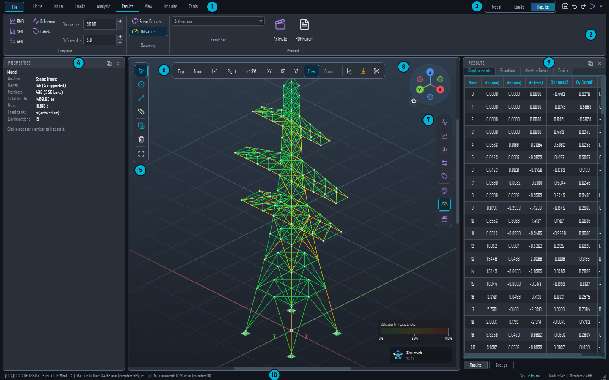

1. **Ribbon tabs**, with the **File** button at the far left (new, open, save, import,
   export, recent files).
2. **Ribbon**: the commands of the current tab, in named groups.
3. **Workspace switcher** (Model · Loads · Results), then the quick buttons: Save, Undo,
   Redo and Solve.
4. **Properties panel**: the selected node or member, or a summary of the model when nothing
   is selected.
5. **Tools strip**: select, add node, add member, measure, duplicate, delete, zoom to fit.
6. **View strip**: view directions, working plane, local axes, load arrows, section cut.
7. **Results strip**: deformed shape, diagrams, value labels, colouring, animation.
8. **Axis gizmo**: shows the world axes and turns the view.
9. **Results panel**: displacements, reactions, member forces and design checks. The
   **Groups** panel shares this place (tabs at the bottom).
10. **Status bar**: messages, the solve summary (largest deflection and moment), the cursor
    coordinates, the analysis type and the model size.

## 2.2 The ribbon

Every command is defined once and appears in the same form on the ribbon, in the floating
strips and in the classic menus. Hover over any button for a description and its shortcut.
**Ctrl+F1** collapses the ribbon to its tabs to give the view more room.

### Home

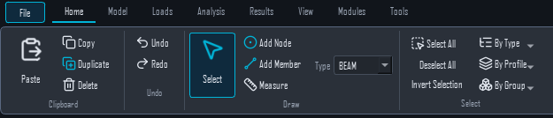

Clipboard (paste, copy, duplicate, delete), undo and redo, the drawing modes (select, add
node, add member, measure) with the element type for new members, and selection (all, none,
invert, by type, by profile, by group).

### Model

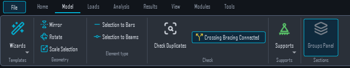

Template wizards; geometry tools (mirror, rotate, scale); element type of the selection
(bars or beams); checks (duplicate nodes and members, crossing bracing); supports for the
selected nodes; the Groups panel.

### Loads

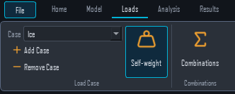

The active load case (add, remove), self-weight, and the load combinations.

### Analysis

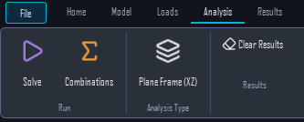

Solve (F5), combinations, the analysis type (Plane Frame (XZ) on or off), clear results.

### Results

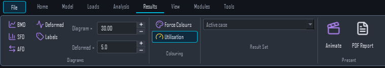

Diagrams (BMD, SFD, AFD, deformed shape, value labels) with their scales, member colouring
(axial force, utilisation), the result set (a load case or a combination), animation and the
PDF report.

### View

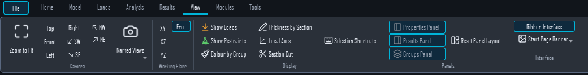

Camera (zoom to fit, eight view directions, named views), the working plane, display options
(loads, restraint markers, colour by group, thickness by section, local axes, section cut,
selection shortcuts) and the panels.

### Modules and Tools

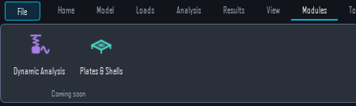

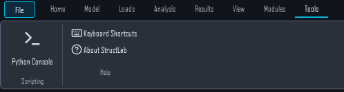

**Modules** lists the analysis modules; a module marked *soon* opens a card describing it.
**Tools** has the Python console (Ctrl+\`), the keyboard shortcuts and About.

### Classic menus

If you prefer menus and toolbars, turn off **View → Ribbon Interface**. The change applies the
next time StructLab starts.

## 2.3 Workspaces

A workspace arranges the window for one stage of the work. Switch with the
**Model · Loads · Results** control at the top right.

| Workspace | Ribbon tab | Panels | Results strip | Load arrows |
|---|---|---|---|---|
| **Model** | Model | Properties | hidden | shown |
| **Loads** | Loads | Properties | hidden | shown |
| **Results** | Results | Properties, Results, Groups | shown | hidden |

Opening or creating a model starts in **Model**; a successful solve opens **Results**.
Clicking a ribbon tab never changes the workspace, so you can reach any command from any
workspace.

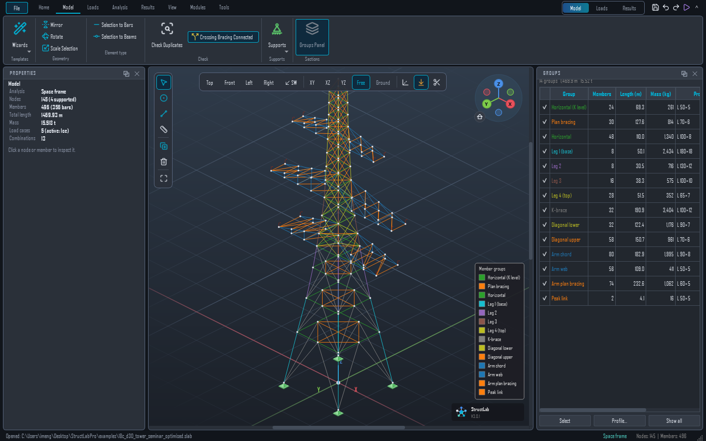

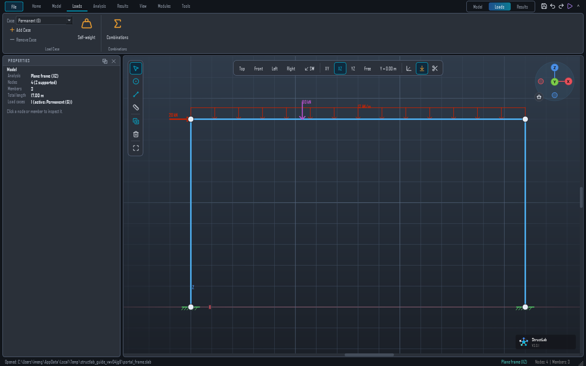

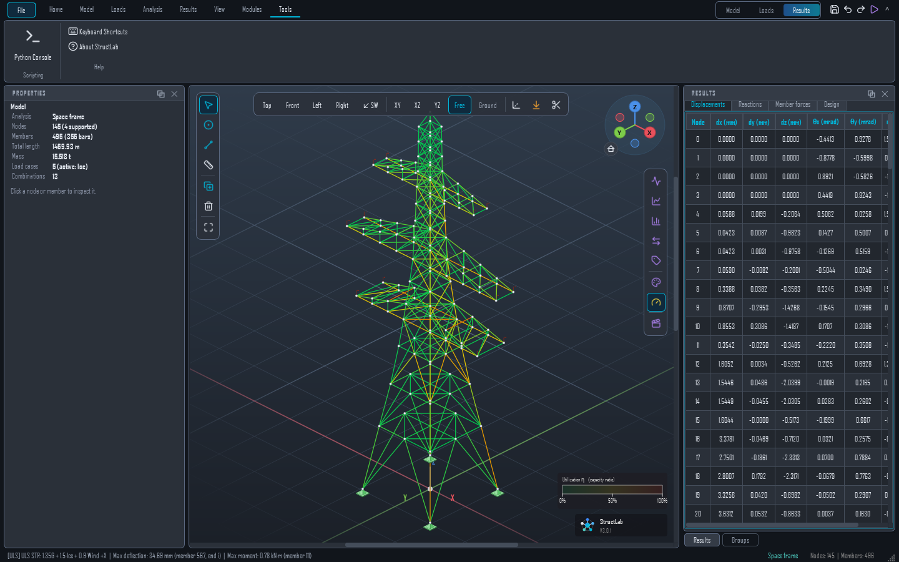

## 2.4 The view

### Moving around

| Action | Mouse or key |
|---|---|
| Zoom (towards the cursor) | Mouse wheel |
| Pan | Drag with the middle button |
| Orbit (3D) | Shift + drag with the middle button; turns about the selection, if any |
| Zoom to fit | **F**, or double-click the middle button |
| Look along an axis | Click a ball on the axis gizmo |

### The axis gizmo

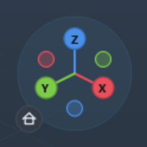

The coloured balls are the positive axes (X red, Y green, Z blue); the dim ones are the
negative axes. Click a ball to look along that axis: +Z gives the Top view, −Y the Front view,
+X the Right view. The small house button returns to the home view. Right-click the gizmo for
the named views, where you can also save the current view; named views are stored in the
`.slab` file.

### The floating strips

The three strips float inside the view and carry the same commands as the ribbon. When the
window is narrow, the view strip drops its view buttons and then hides.

- **Tools** (left): Select (S), Add Node (N), Add Member (M), Measure (R), Duplicate
  (Ctrl+D), Delete (Del), Zoom to Fit (F).
- **View** (top): Top, Front, Left, Right and SW views; the working plane (XY, XZ, YZ or Free)
  and its offset; local axes; load arrows (L); section cut.
- **Results** (right, in the Results workspace): deformed shape, BMD, SFD, AFD, value
  labels, force colours, utilisation colours, animation.

### Working plane

New nodes are placed on the working plane. **XY** holds Z at the plane offset, **XZ** holds Y,
**YZ** holds X, and **Free** places nodes at Z = 0. Click the offset button (for example
`Z = 0.00 m`) to type the plane's position. A plane frame always works in XZ.

### The ground grid

The grid lies in the XY plane with the X axis in red and the Y axis in green. It fades as the
view approaches edge-on, so it never hides an elevation.

## 2.5 Panels

| Panel | Shortcut | Contents |
|---|---|---|
| Properties | Alt+1 | The selected node or member, editable; a model summary when nothing is selected |
| Results | Alt+2 | Displacements, reactions, member forces and design, for the active result set |
| Groups | Alt+3 | Member groups: visibility, count, length, mass and profile; select or re-profile a group |

Panels can be closed, floated or docked elsewhere. **View → Reset Panel Layout** puts them
back.

## 2.6 Interface preferences

These are remembered between sessions, per Windows user:

- **Ribbon Interface**: the ribbon (default) or classic menus and toolbars.
- **Start Page Banner**: rotate through the banner themes, or keep one.
- **Selection Shortcuts**: a reminder of the keys that act on a selection (G, E, I, Ctrl+D,
  Del…) shown over the view while something is selected.
