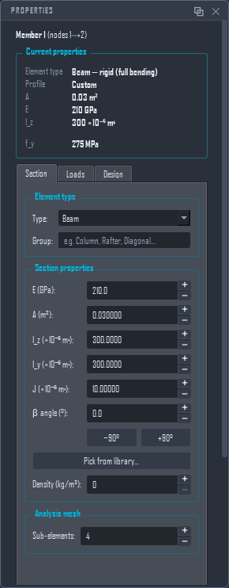
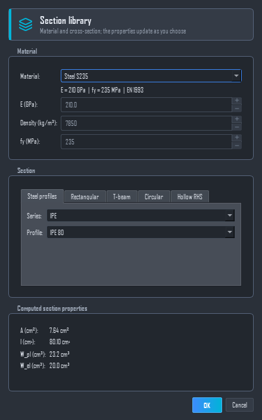
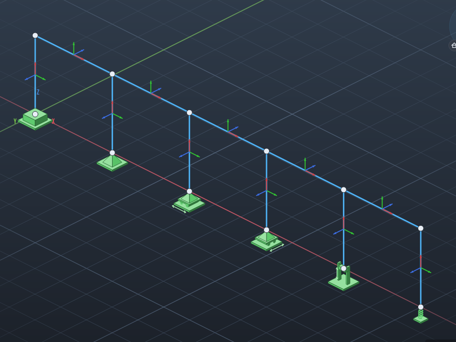

# 3. Building a model

A model is made of **nodes** (points in space) joined by **members** (straight elements).
Every member has a section, a material and an element type; nodes carry the supports and
the nodal loads. Units in the interface are metres, kilonewtons and degrees unless a field
says otherwise.

## 3.1 Three ways to start

- **A template** (Model → Wizards, or a template on the start page): a continuous beam,
  portal frame, truss or multi-storey frame, complete with sections and loads.
- **Drawing** nodes and members on the canvas, described below.
- **Importing** nodes and members from a CSV file (File → Import → From CSV), or building
  the model in a Python script with the SDK. Both are described in chapter 10.

## 3.2 Drawing nodes and members

| Mode | Key | What a click does |
|---|---|---|
| Select | S | Select a node or member; drag a box to select several |
| Add Node | N | Place a node on the working plane |
| Add Member | M | Drag from one node to another to join them |
| Measure | R | Click two nodes to show the distance between them |

The modes are on the Home tab and on the tools strip at the left of the view.

- New nodes **snap** to a 0.25 m grid on the working plane (chapter 2.4). A click where a node
  already exists adds nothing.
- When you draw a member, each end snaps to the nearest node under the cursor.
- A new member takes the element type chosen in **Home → Draw → Type** (Beam by default).
- In a plane frame, draw in the Front view: nodes are always placed in the XZ plane.

To place a node at exact coordinates, add it anywhere and type its coordinates in the
Properties panel.

## 3.3 Selecting

- Click selects one item; **Ctrl+click** adds or removes items.
- Drag a box in Select mode: **left to right** selects what lies wholly inside the box,
  **right to left** also selects what the box touches. Hold **Ctrl** to add to the selection.
- **Ctrl+A** selects all, **Ctrl+Shift+A** clears the selection, **Ctrl+I** inverts it.
- **Home → Select → By Type / By Profile / By Group** selects every member of one kind.
- Right-click a member and choose **Select Same → Group** or **Section** to select every
  member like it.
- **I** isolates the selection (everything else is hidden); press **I** again to show all.

With several items selected, the Properties panel shows what they have in common and buttons
to narrow the selection (for example to the supported nodes only).

## 3.4 Moving and shaping

With nodes selected, these keys work directly in the view:

| Key | Action |
|---|---|
| **G** | Grab: move the selection with the mouse |
| **E** | Extrude: copy the selected nodes, join each copy to its original with a new member, and grab the copies |
| **S** | Scale the selection about its centroid |
| **X / Y / Z** | During G or E: move only along that axis |
| **A** | During G or E: slide along a member attached to the node; **A** again picks the next member |
| **0–9 . −** | Type an exact distance (or scale factor), then **Enter** |
| **Enter** or left click | Confirm |
| **Esc** or right click | Cancel |

A free mouse move snaps to the 0.25 m grid; a typed distance or a slide along a member is
exact. Each move is one undo step (**Ctrl+Z**).

**Example:** to raise a column top by exactly 0.5 m, select the node, press **G**, **Z**,
type `0.5` and press **Enter**.

## 3.5 Copying, mirroring and rotating

| Command | Where | What it does |
|---|---|---|
| **Duplicate** (Ctrl+D) | Home, tools strip | Copies the selection along X, Y or Z: an offset in metres and a number of copies |
| **Copy / Paste** (Ctrl+C / Ctrl+V) | Home | Pastes a copy beside the original, shifted along X by the copied part's width (at least 1 m) |
| **Mirror…** | Model → Geometry | Mirrors the selection about the XY, XZ or YZ plane, keeping the original or not |
| **Rotate…** | Model → Geometry | Rotates by an exact angle about X, Y or Z, about the selection's centroid or a given point, optionally as copies |
| **Scale Selection…** | Model → Geometry | Scales the selected nodes about their centroid (or press **S**) |

To build a symmetric structure (a tower, a dome), model one part and rotate copies of it
about a point on the structure's axis.

## 3.6 Member properties

Select a member to see its properties. The **Section** tab holds what the analysis uses:

| Field | Meaning |
|---|---|
| **Type** | Beam, Bar, Pin-Left or Pin-Right (see 3.7) |
| **Group** | A free label (Column, Rafter, Diagonal…) used by the Groups panel, colouring, selection and Optimise |
| **E** | Young's modulus, GPa |
| **A** | Cross-section area, m² |
| **I_z** | Second moment of area for bending in the member's main plane (the strong axis), ×10⁻⁶ m⁴ |
| **I_y** | Second moment of area about the weak axis, ×10⁻⁶ m⁴ (space frames) |
| **J** | Torsion constant, ×10⁻⁶ m⁴ (space frames) |
| **β angle** | Rotation of the section about the member axis; the −90° / +90° buttons turn it a quarter turn |
| **Density** | kg/m³, for self-weight; 0 means the member has no self-weight |
| **Sub-elements** | Analysis mesh; see below |

The **Loads** tab holds the member's distributed and point loads in the active load case
(chapter 5); the **Design** tab holds what the design checks need (chapter 8).

**Sub-elements.** Results are exact along every element, whatever the number of
sub-elements: bending moment, shear and deflection are worked out from the loads on each
element. The default of 4 is enough for nearly every model; more sub-elements only refine the
drawn deformed shape.

**Divide into elements** (Halve, 5 nodes, 10 nodes, Custom) splits the member into real
members with new nodes, where you can then attach supports, loads or other members.

### The section library

**Pick from library…** opens the section library:

1. Choose a **material**: steel S235 to S460, concrete C20/25 to C40/50, timber GL24h and
   GL28h, aluminium, or Custom. This sets E, the density and the strength.
2. Choose a **section**: a steel profile (IPE, HEA, HEB, CHS, RHS, equal angles to
   EN 10056-1), or a rectangular, T, circular or hollow rectangular section by its dimensions.
3. The computed properties are shown at the bottom; **OK** writes them to the member.

> **Space frames: I_y and J.** For equal angles the library also fills in the weak-axis
> I_y and the torsion constant J. For I-sections and the other shapes it fills in A and the
> strong-axis I only: enter I_y and J yourself for members of a space frame. After a solve,
> StructLab lists any space-frame member still missing them.

### The Groups panel

**Model → Groups Panel** (Alt+3) lists the member groups: a colour swatch, visibility, the
number of members, total length, mass and profile. Select a row and use **Select** to select
its members, or **Profile…** to give every member of the group one library profile.
**View → Colour by Group** (Ctrl+G) tints members by group, with a legend on the canvas.

## 3.7 Element types and end releases

| Type | Behaviour | Use for |
|---|---|---|
| **Beam** | Rigidly connected at both ends: axial force, shear, bending and torsion | Beams, columns, frame members |
| **Bar** | Pinned at both ends: axial force only; its self-weight is carried to its two end nodes | Truss and bracing members |
| **Pin-Left** | Moment released at the member's first node (I end) | A beam pinned into a column at one end |
| **Pin-Right** | Moment released at the second node (J end) | The same, at the other end |

In a space frame a released end transmits no bending moment about either axis; the member
still carries torsion. **Model → Selection to Bars** and **Selection to Beams** change the
type of all the selected members at once, keeping their sections and groups.

A node where only bars meet has no rotational stiffness of its own. StructLab handles this
for you: such a node needs no rotational support.

## 3.8 Local axes

Each member has its own axes:

- **x** runs along the member from its first node to its second.
- **y** points to the top of the section: towards +Z for a sloping or horizontal member, and
  along global X for a vertical member. **I_z** is for bending in the x–y plane.
- **z** completes the right-handed set; **I_y** is for bending in the x–z plane.
- **β** rolls y and z about x.

**View → Local Axes** draws them on every member (x red, y green, z blue):

## 3.9 Checking the geometry

- **Model → Check Duplicates…** finds nodes at the same place and members that duplicate
  another or have zero length; **Merge & Remove** fixes them in one undoable step.
- **View → Section Cut…** hides everything on one side of a plane to look inside a structure;
  a member is hidden only when both its nodes are beyond the plane.
- **Measure** (R) shows the distance between two nodes.
- **Model → Crossing Bracing Connected** is a design assumption for towers, described in
  chapter 8. It does not change the analysis.
