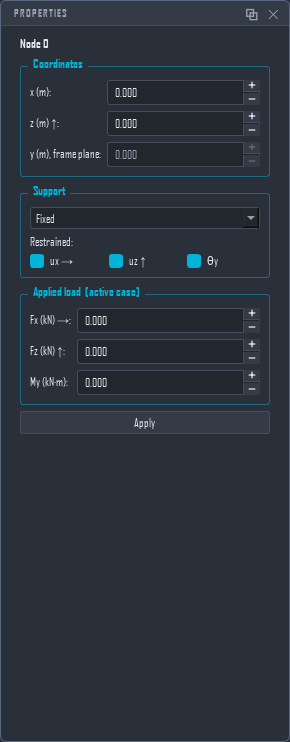
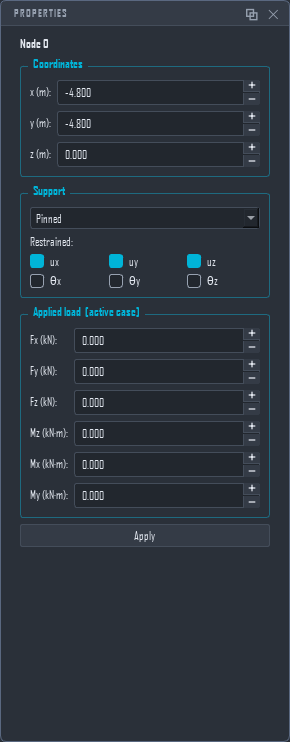
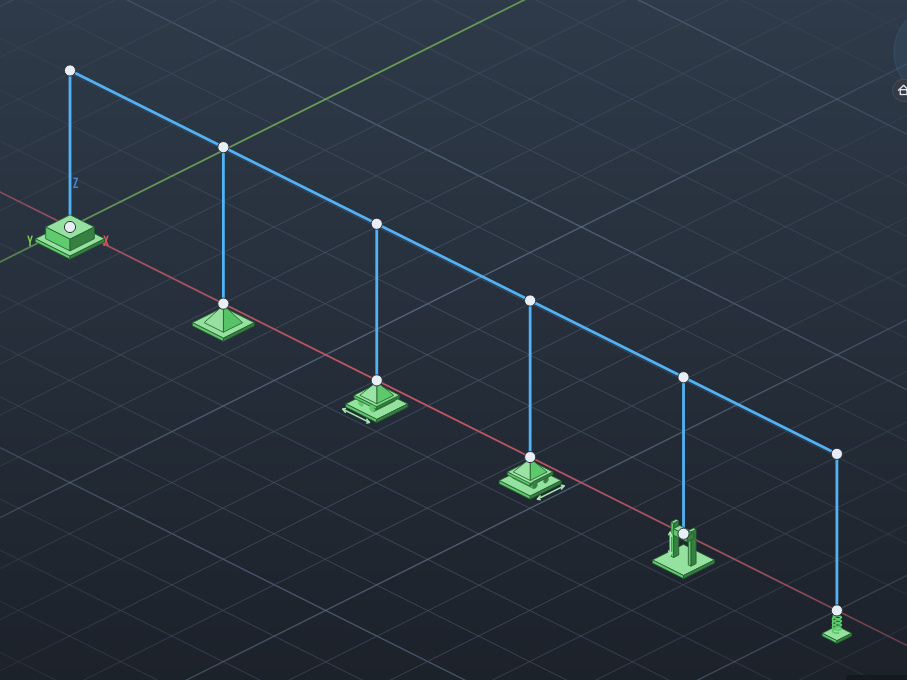
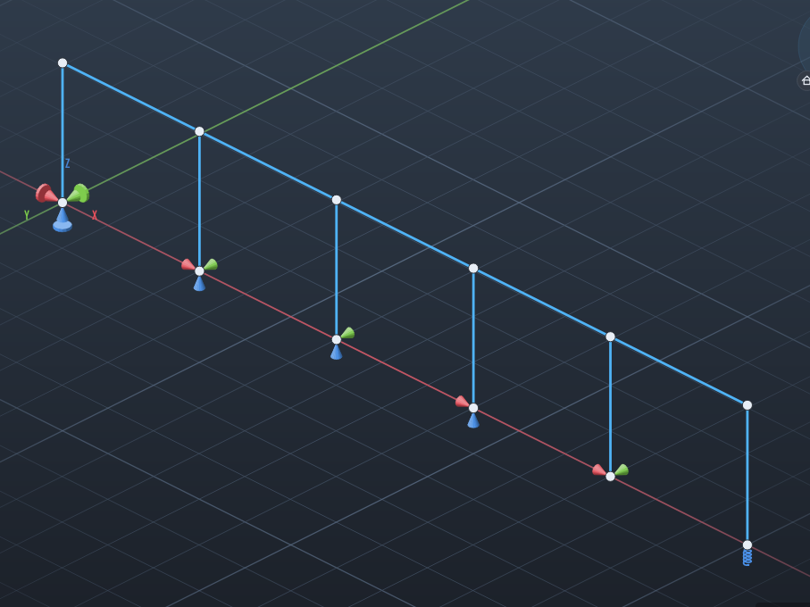
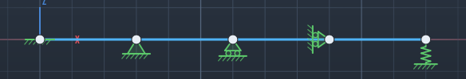

# 4. Supports and releases

A support holds a node against movement in some directions. A release frees one end of a
member from the node it is attached to. Together they decide how the structure is held and
how its parts are connected.

## 4.1 Assigning a support

Select one or more nodes, then do one of these:

- **Model → Supports** and pick a type;
- right-click the node and choose **Set Support**;
- choose the type in the **Support** box of the Properties panel, where you can also tick
  individual directions and add springs.

The Properties panel for a plane-frame node (in-plane directions only) and for a
space-frame node (all six):

## 4.2 Support types

The six directions of a node are three translations (ux, uy, uz) and three rotations
(θx, θy, θz), all along the global axes.

| Type | Held | Free | Typical use |
|---|---|---|---|
| **Fixed** | All six | — | Column base cast into a foundation |
| **Pinned** | ux, uy, uz | All rotations | Bolted base plate, pinned bearing |
| **Roller, free in X** | uy, uz | ux, rotations | Sliding bearing, expansion joint along X |
| **Roller, free in Y** | ux, uz | uy, rotations | Sliding bearing along Y (space frames) |
| **Roller, free in Z** | ux, uy | uz, rotations | A node held sideways only, such as a wall restraint |
| **Spring** | — | — | Elastic support: a stiffness in chosen directions (4.4) |
| **Custom** | Any combination | | Anything the presets do not cover |

In a **plane frame** the panel shows only the in-plane directions: ux, uz and θy. The other
three (uy, θx, θz) are held at every node by the plane-frame analysis itself, so they need no
support; the forces there are not reported as reactions.

## 4.3 Holding single directions

Tick or clear the boxes under **Restrained** to hold exactly the directions you need. The
type changes to the matching preset, or to **Custom** when none matches. For example, a pinned
base that is also held against twisting about the vertical axis is Pinned plus θz: Custom.

If the selected nodes have different supports, the panel shows the first node's support and
says so; a change then applies to all of them.

## 4.4 Springs

A spring gives a node an elastic stiffness in a free direction:

- choose **Spring**, or **Custom** to combine held directions with springs;
- type the stiffness in the **Spring stiffness on free DOFs** box: N/m for translations,
  N·m/rad for rotations. A direction with zero stiffness is free.

Typical uses are a pile or a soil support (vertical spring), a semi-rigid base (a rotational
spring on a pinned base: Custom), or a support provided by a structure you are not modelling.
Spring forces are reported as reactions, so the reactions always balance the loads.

## 4.5 How supports are drawn

In 3D each support is drawn as a bearing: a footing block for a fixed support, a pyramid for
a pinned one, a pyramid on rollers or rails for the rollers, and a coil for a spring.

**View → Show Restraints** draws instead exactly what the solver holds: a cone into the node
for each held translation and a disc for each held rotation, in the axis colours (X red,
Y green, Z blue), and a coil for each spring.

A plane frame seen in elevation (Front or Back view) uses the drawing-office symbols:

## 4.6 End releases

A member end is released by its element type (chapter 3.7):

| Type | Released |
|---|---|
| **Beam** | Nothing: both ends rigidly connected |
| **Pin-Left** | Bending moment at the first node (I end) |
| **Pin-Right** | Bending moment at the second node (J end) |
| **Bar** | Bending moment at both ends: axial force only |

In a space frame a released end carries no bending moment about either axis; torsion is
still transmitted.

**Pinned support or released end?** A pinned *support* frees the node itself: every member
attached to it can rotate together. A released *end* frees only that member: the other
members at the node stay rigidly connected to each other. A beam resting on a continuous
column is a Pin-Left or Pin-Right beam; a column on a hinged base is a pinned support.

A hinge in the middle of a frame (a three-pinned portal, for example) is a node where the
members on one side, or all of them, are released. If every member at a node is released and
the node is free, the node has no rotational stiffness at all: StructLab still solves it as
long as no moment is applied there, and reports a mechanism if one is.

## 4.7 Enough supports?

The supports must stop the whole structure from moving as a rigid body: three independent
reactions in a plane frame, six in a space frame, arranged so that they cannot all rotate
about one point or one line. If the model can move without straining (a mechanism),
the solve stops and names the nodes that move most (chapter 6).
