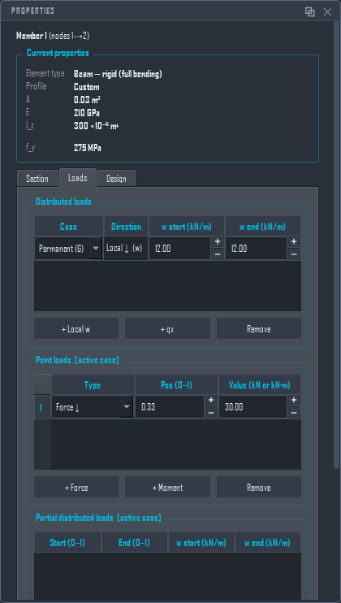
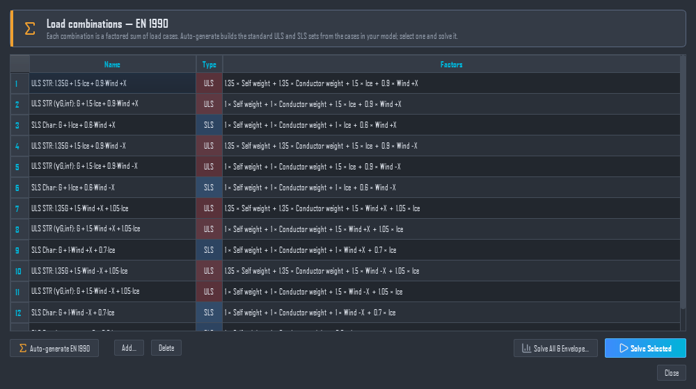

# 5. Loads

Loads belong to **load cases**: a case is one named set of loads (dead load, imposed load,
wind from the left…). Each case is solved on its own, and **combinations** add the cases
together with partial factors.

## 5.1 Load cases

The **Loads** tab holds the case list:

- **Case**: the active case. New loads go into it, the view draws its loads, and **Solve**
  (F5) solves it. **All Cases** shows the loads of every case at once (to solve them together,
  use combinations).
- **Add Case**: a name and a **category**. The category decides the partial and ψ factors
  in the generated combinations, so choose it carefully: it cannot be changed later in the
  window.
- **Remove Case**: removes the active case and all its loads, after asking.

| Category | Treated as | ψ₀ | ψ₂ |
|---|---|---|---|
| **Permanent (G)** | Permanent action | — | — |
| **Variable (Q)** | Imposed load | 0.7 | 0.3 |
| **Wind (W)** | Variable action | 0.6 | 0 |
| **Snow (S)** | Variable action | 0.5 | 0.2 |

The ψ values are the EN 1990 Annex A1 recommended values for buildings.

## 5.2 Nodal loads

Select one or more nodes; the **Applied load** box of the Properties panel shows the loads in
the active case. Type the values and click **Apply**.

| Model | Forces (kN) | Moments (kN·m) |
|---|---|---|
| Plane frame | Fx (→ positive), Fz (↑ positive) | My |
| Space frame | Fx, Fy, Fz, positive along the global axes | Mx, My, Mz, right-hand rule about the global axes |

A downward load is therefore a **negative** Fz.

## 5.3 Member loads

Select a member and open the **Loads** tab of the Properties panel:

### Distributed loads

The table lists the member's distributed loads in **every** case; the **Case** column says
which. Each row has a direction and an intensity at each end (kN/m), varying linearly in
between:

| Direction | Acts | Positive |
|---|---|---|
| **Local w** | Perpendicular to the member, in its main bending plane | Towards the member's local −y: **downwards** on a horizontal member |
| **qx** | Along global X | Towards +X |
| **qy** | Along global Y (space frames only) | Towards +Y |

All intensities are per metre of member length. On a **sloping** member, **w** acts
perpendicular to the member, not vertically: for a roof load given per metre on plan, work
out the equivalent intensity along the rafter yourself.

### Point loads

**+ Force** and **+ Moment** add a concentrated load in the active case at a position given
as a fraction of the length from the member's first node (0 = start, 0.5 = midspan,
1 = end). A force is positive towards local −y (downwards on a horizontal member), in kN; a
moment is in kN·m.

### Partial distributed loads

**+ Partial load** adds a distributed load over part of the member, between a start and an
end position (fractions of the length), varying linearly from *w start* to *w end*. It acts
like a local w.

Click **Apply** to store the member's loads. Diagrams and results are exact at point loads
and at the ends of partial loads; you never need to split a member to place a load.

## 5.4 Self-weight

**Loads → Self-weight** switches self-weight on: StructLab creates (or reuses) a permanent
case called **Self-weight** in which every member carries its own weight, acting along −Z.
The weight is the member's area × density × g, so a member with density 0 has none.
Only one case carries self-weight. Click the button again to switch it off.

A beam takes its self-weight as a distributed load along its length; a bar takes it at its two
end nodes.

## 5.5 Seeing the loads

Loads of the active case are drawn as arrows with their values: distributed loads along the
member, point loads at their position, nodal loads at the node. **L** (or View → Show Loads)
hides or shows them. The **Loads** workspace shows them; the **Results** workspace hides them.

## 5.6 Load combinations

**Loads → Combinations…** (or Analysis → Combinations) manages the combinations:

### Generating them

**Auto-generate EN 1990** builds the fundamental combinations of EN 1990 Table A1.2(B) from
your cases. With G the permanent cases and each variable case taken in turn as the leading
action:

| Set | Combination |
|---|---|
| ULS STR, permanent alone (one) | 1.35 G |
| ULS STR, γG,sup | 1.35 G + 1.5 Qlead + Σ 1.5 ψ₀ Qothers |
| ULS STR, γG,inf | 1.00 G + 1.5 Qlead + Σ 1.5 ψ₀ Qothers |
| SLS characteristic | G + Qlead + Σ ψ₀ Qothers |
| SLS quasi-permanent (one) | G + Σ ψ₂ Q |

A variable action is included only where it is unfavourable, so **1.35 G** alone is a
combination too: it governs wherever the variable actions relieve a member (chapter 9.1
shows a case). The γG,inf set matters where permanent load is favourable: uplift,
overturning, and the tension in tower legs. With no variable case, one ULS (1.35 G) and one
SLS (1.0 G) combination are made. Running it again replaces the generated combinations and
keeps any you added yourself.

The generator always includes every other variable action as a companion. Where a
companion relieves a member (for example ice reducing the uplift under wind), the
combination without it is not generated; add it with **Add…** if it can govern.

**Alternative cases.** Wind from +X and wind from −X never act together. Cases marked as
alternatives (an *exclusive group*, such as the tower example's two wind cases) are never
combined with each other. The group is stored in the `.slab` file and set by the tower
generator and the SDK; the window does not edit it yet.

> **Seismic actions** are not part of StructLab yet; they will come with the Dynamic
> Analysis module. A seismic (E) case in a file from an older version still opens with its
> loads, but the generator leaves it out (and says so); use it only in a combination you
> build with **Add…**.

### Your own combinations

**Add…** asks for a name, the limit state (ULS or SLS) and a factor for each case. Factors
can be any value, including 0 to leave a case out.

### Solving them

- **Solve Selected** solves one combination and shows its results in the window.
- **Solve All & Envelope…** solves every combination and opens the envelope: the largest and
  smallest values of every result over all of them (chapter 7).

The result set shown in the window is chosen in **Results → Result Set**.

## 5.7 Pattern loading

On continuous beams and frames, loading every span at once does not give the largest span
moment: EN 1992-1-1 5.1.3 asks for patterns with alternate spans loaded and adjacent spans
loaded. **Solve All & Envelope** checks the model for runs of two or more connected members
carrying variable loads. When it finds one, it adds the critical patterns as extra ULS runs
(1.35 G on every span, 1.5 Q on the loaded spans only) and the envelope includes them, saying
which members the patterns govern.
