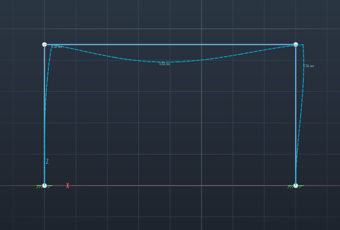
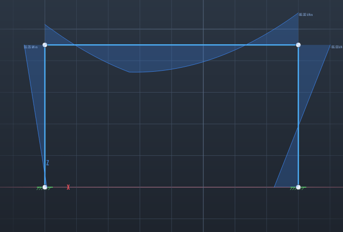
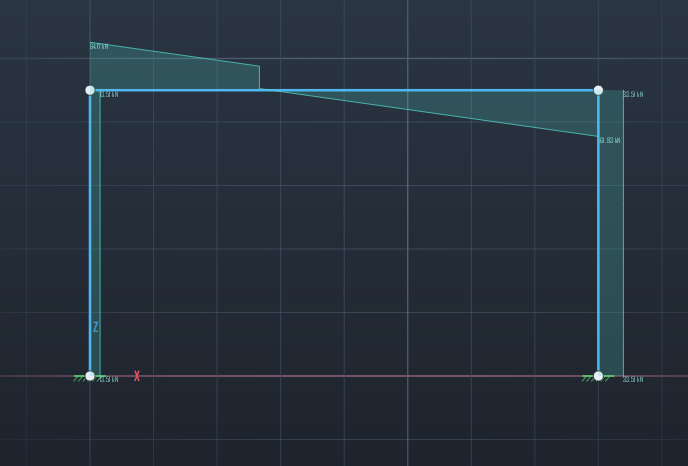
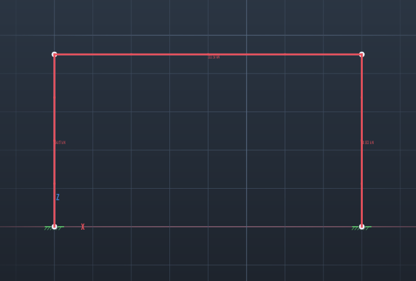
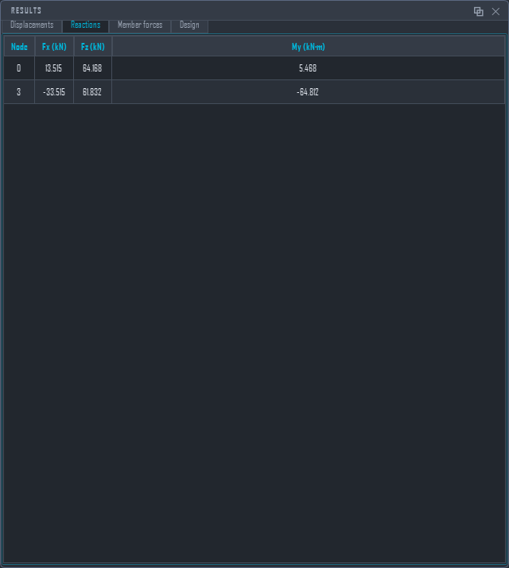
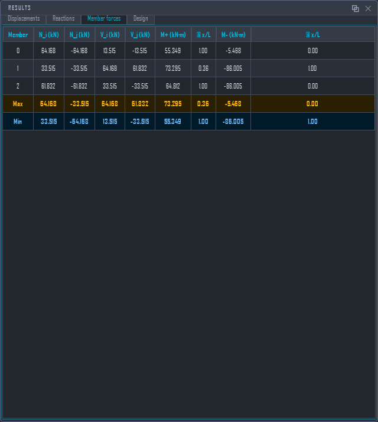
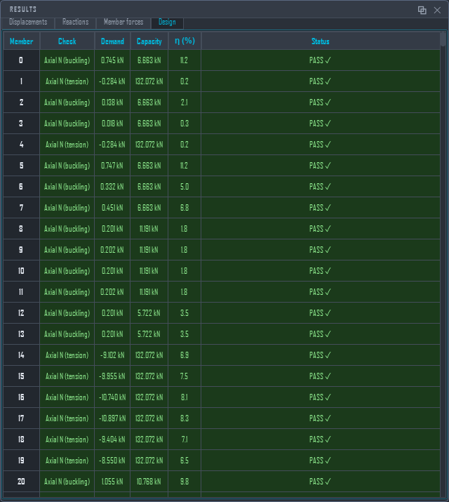

# 7. Results

After a solve the window opens the **Results** workspace: the diagrams on the model, the
Results panel with its tables, and the results strip at the right of the view. The examples in
this chapter are the portal frame of chapter 1 (8 m span, 4.5 m columns, fixed bases,
12 kN/m and 30 kN on the beam, 20 kN sideways at the left eave).

## 7.1 Diagrams

Turn the diagrams on and off on the **Results** tab or the results strip. **Labels** adds the
values: the end values and the peak of each member.

| Diagram | Shows | Drawn |
|---|---|---|
| **Deformed** | The deflected shape, magnified | Dashed, over the undeformed model |
| **BMD** | Bending moment | On the tension side: sagging below a beam, hogging above |
| **SFD** | Shear force | Positive above the member; a downward point load steps it down |
| **AFD** | Axial force | Compression red, tension blue |

**Diagram ×** and **Deformed ×** on the Results tab scale the drawing only; they never change
the values. The diagrams are exact along each member: the peak of a span moment is drawn and
labelled where it really is, even between nodes.

**Animate** plays the deformed shape from the undeformed position to full size, in a loop.

## 7.2 Which results are shown

**Results → Result Set** chooses what the diagrams, tables and colours show:

- **Active case**: the load case you solved with F5;
- each **combination** solved with *Solve All & Envelope*, by name.

A single combination solved with *Solve Selected* replaces the active-case results.

## 7.3 The Results panel

The Results panel (Alt+2) has four tabs. Selecting rows selects the nodes or members in the
view, and selecting in the view highlights their rows.

### Displacements and reactions

Displacements are in mm and rotations in mrad, along the global axes; reactions are in kN and
kN·m. A plane frame shows its in-plane columns (dx, dz, θy and Fx, Fz, My); a space frame
shows all six.

### Member forces

| Column | Meaning |
|---|---|
| **N_i, N_j** | Axial force at the I and J ends |
| **V_i, V_j** | Shear force at the I and J ends |
| **M+**, **@ x/L** | Largest sagging moment along the member and where it occurs (0 = I end, 1 = J end) |
| **M−**, **@ x/L** | Largest hogging moment and where it occurs |

N and V are the forces the nodes apply to the member's ends, in the member's local axes. For
a member in pure compression, N_i is positive and N_j negative (column 0 above: +64.2 and
−64.2 kN); in tension the signs reverse. For the beam (member 1), V_i and V_j are the two end
shears, 64.2 + 61.8 = 126 kN, which is the total load on it (12 × 8 + 30). The **Max** and
**Min** rows give the extreme value of each column.

M+ and M− are the true peaks along the member, not just the end values: the beam's span
moment of 73.3 kN·m occurs at x/L = 0.36, just past the point load at one third of the span,
where the shear passes through zero.

### Design

One row per member and check: the check (for example *Axial N (buckling)*), the design force,
the resistance, the utilisation η in % and PASS or FAIL. Chapter 8 explains the checks.

## 7.4 On the model

- **Hover** over a member to see its group, profile, length and mass, and after a solve its
  axial force (tension or compression), peak moment and utilisation. Hover over a node for its
  coordinates and support, and after a solve its displacement and any reaction.
- **Force Colours** colours members by axial force: red in compression, blue in tension, the
  strength of the colour following the size of the force.
- **Utilisation** colours members by their design utilisation, from green (low) through
  yellow to red (100 %), with a legend. Members that cannot be checked keep their normal
  colour. See chapter 8 for what the number includes.

Both colourings follow the result set and stay on while you zoom and turn the view.

## 7.5 The envelope

**Solve All & Envelope…** in the combinations dialog solves every combination (and the
pattern-loading runs, chapter 5.7) and opens the **Envelope Results** window:

- **Node Displacements**: the largest and smallest displacement of each node over all
  combinations, and which combination gives it;
- **Member Forces**: the same for the member forces;
- **BMD Envelope** and **SFD Envelope**: the maximum and minimum diagrams of every member,
  drawn together.

## 7.6 The PDF report

**Results → PDF Report** (or File → Export → PDF Report) asks which load case or combination
to report on, solves it, and writes an A4 report:

1. Title page, with the project details from **File → Project Info** (title, reference,
   client, company, designer, reviewer, approver and status: Preliminary, For Review or
   Approved);
2. the model: nodes, members and sections;
3. a picture of the structure;
4. the loading;
5. the support reactions;
6. serviceability checks: deflection against span / 300 and sway against height / 300;
7. the member end forces;
8. the shear force and bending moment diagram of each member;
9. a sign-off page.

Very long tables are cut to fit their page, with a line saying how many rows are not shown.

## 7.7 Pictures and views

- **File → Export → PNG Image** or **SVG Vector** saves the current view.
- **View → Named Views** saves the current camera under a name and returns to it later; named
  views are stored in the `.slab` file.
- **View → Section Cut…** hides part of the model to show the inside of a structure.
