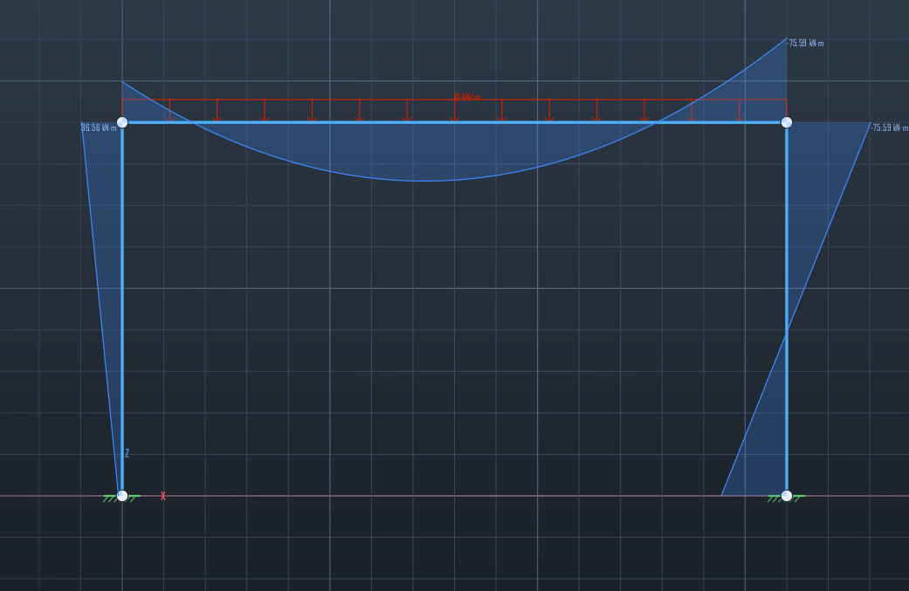
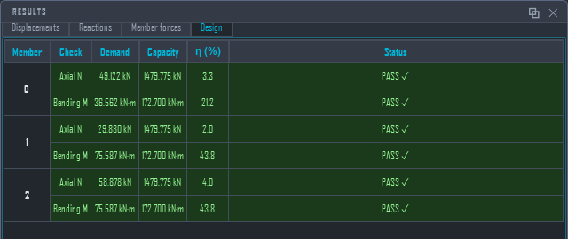
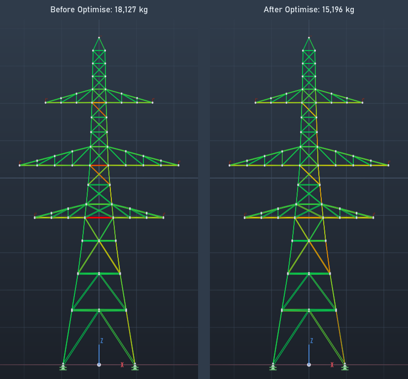

# 9. Worked examples

Two complete examples, from an empty window to checked results. The first is small enough
to check by hand; the second shows the workflow on a real lattice structure.

## 9.1 A portal frame, checked by hand

### The structure

| | |
|---|---|
| Geometry | Span 8 m, column height 4.5 m, fixed bases |
| Members | IPE 300 throughout, steel S275 (fy = 275 MPa) |
| Dead load (G) | 10 kN/m on the beam |
| Wind (W) | 15 kN horizontal at the left eave, towards +X |

### Building it

1. On the start page click **New plane frame**. The view opens from the front, on the XZ
   plane.
2. Add four nodes at (x, z) = (0, 0), (0, 4.5), (8, 4.5) and (8, 0), and join them with three
   members: left column, beam, right column (chapter 3). To place a node exactly, select it
   and type its coordinates in the Properties panel.
3. Select the two base nodes and give them a **Fixed** support (chapter 4).
4. Select the three members, click **Pick from library…**, choose **IPE 300** with the
   material **Steel S275**. This sets E, A, I, W<sub>pl</sub> and W<sub>el</sub>.
5. A new model has one load case, *Permanent (G)*. Use it for the dead load: on the beam's
   **Loads** tab add a **Local w** row of 10 kN/m at both ends, and click **Apply**
   (chapter 5.3).
6. **Add Case** *Wind*, category **Wind (W)**. Select the left eave node and apply
   Fx = 15 kN.

The categories matter: the generated combinations take their factors from them.

### Solving each case and checking it

Choose the dead load case and press **F5**. For a fixed-base portal with the same section
in the beam and the columns, the classical Kleinlogel formulas give, with
k = (I<sub>beam</sub> / I<sub>column</sub>) (h / L) = 4.5 / 8 = 0.5625:

| Dead load, 10 kN/m | Hand formula | StructLab |
|---|---|---|
| Vertical reaction at each base | wL / 2 = 40.0 kN | 40.00 kN |
| Moment at the eaves | wL² / (6 (k + 2)) = 41.63 kN·m | 41.57 kN·m |
| Moment at the bases | wL² / (12 (k + 2)) = 20.81 kN·m | 20.66 kN·m |
| Horizontal reaction | 3 M<sub>base</sub> / h = 13.88 kN | 13.83 kN |
| Moment at midspan | wL² / 8 − M<sub>eaves</sub> = 38.37 kN·m | 38.43 kN·m |

The small differences are real, not rounding: the hand formulas ignore the beam's axial
shortening under its 13.8 kN thrust, which lets the eaves move in by 0.1 mm. Give the members
a very large area and StructLab returns the hand values exactly.

Then choose *Wind* and solve:

| Wind, 15 kN at the eave | Hand formula | StructLab |
|---|---|---|
| Horizontal reaction at each base | P / 2 = 7.5 kN | 7.53 and 7.47 kN |
| Moment at the bases | Ph (3k + 1) / (2 (6k + 1)) = 20.73 kN·m | 20.83 and 20.66 kN·m |
| Moment at the eaves | 3k Ph / (2 (6k + 1)) = 13.02 kN·m | 13.04 and 12.98 kN·m |
| Vertical reactions | (Ph − 2 M<sub>base</sub>) / L = 3.25 kN | −3.25 kN (uplift) at the left, +3.25 kN at the right |
| Sway at the eaves | | 5.5 mm |

The wind lifts the windward column and presses down on the leeward one. Always check one
or two results like these against a hand calculation before trusting a model.

### Combinations

**Loads → Combinations… → Auto-generate EN 1990** makes five combinations from these two
cases:

| Combination | Use |
|---|---|
| ULS STR: 1.35G | Strength, wind absent |
| ULS STR: 1.35G + 1.5·Wind | Strength, permanent load unfavourable |
| ULS STR (γG,inf): G + 1.5·Wind | Strength, permanent load favourable |
| SLS Char: G + 1·Wind | Deflection and sway |
| SLS Quasi-permanent: G | Long-term deflection (ψ₂ = 0 for wind) |

**Solve All & Envelope…** solves them all. Choose *ULS STR: 1.35G + 1.5·Wind* in
**Result Set** and turn on **BMD** with **Labels**:



The wind adds to the dead-load hogging at the right eave (75.6 kN·m) and takes it away at
the left (36.6 kN·m).

### Design checks

The **Design** tab of the Results panel shows, for this combination:



IPE 300 is not an angle, so each member gets the cross-section check (chapter 8.3): axial
N / (A fy) and bending M / (W<sub>pl</sub> fy), here N<sub>Rd</sub> = 1480 kN and
M<sub>Rd</sub> = 172.7 kN·m. The right column carries 58.9 kN and 75.6 kN·m: 4.0 % and
43.8 %. The utilisation colours and the hover tooltip add the two, 47.7 %. Buckling of the
columns and lateral-torsional buckling of the beam are **not** checked; with these figures
the IPE 300 has plenty in hand, but check them by your usual means.

Sway: under *SLS Char: G + 1·Wind* the eaves move 5.6 mm, against h / 300 = 15 mm.

### Why 1.35 G alone is there

EN 1990 includes a variable action only where it is unfavourable. At the left eave the wind
relieves the dead-load moment, so the combination without it governs there:
1.35 × 41.57 = 56.1 kN·m under **1.35G**, against 36.6 kN·m under 1.35G + 1.5·Wind. The
envelope takes the larger. The frame is symmetric, so wind from the other side mirrors the
results and the right column's figures cover both columns.

## 9.2 A transmission tower

The example `examples/l8c_d30_tower_seminar.slab` is a 400 kV lattice tower of the UK L8(c)
D30 type, built from its published elevation drawing:

| | |
|---|---|
| Size | 43.8 m high, 9.6 m square base, three crossarm levels |
| Model | Space frame, 145 nodes, 496 members in 14 groups, four pinned feet |
| Members | Equal angles from the library; 356 bars (pinned at both ends) and 140 beams (legs and arm chords) |
| Sections | A representative first design, not the tower's real member schedule |

### Opening and looking around

Open the file and press **Alt+3** for the Groups panel: each group (legs by level, bracing,
crossarm members) shows its count, length, mass and profile; hide groups to look inside.
**Ctrl+G** colours the members by group and **Ctrl+T** draws them by section size.

### Loads

| Case | Category | Loads |
|---|---|---|
| Self weight | Permanent (G) | Weight of every member |
| Conductor weight | Permanent (G) | 116.7 kN down, at the 12 attachment points |
| Ice | Variable (Q) | 36.7 kN down |
| Wind +X | Wind (W) | 49.3 kN towards +X |
| Wind −X | Wind (W) | 49.3 kN towards −X |

The cable loads are illustrative estimates for a suspension tower, not the values of
EN 50341-1 and its UK National Annex. The two wind cases are alternatives (chapter 5.6), so
the file's 13 generated combinations never add them together. (Auto-generate again and a
fourteenth, 1.35G alone, is added; it does not govern any member of this tower.)

**Model → Crossing Bracing Connected** is on in this file: the crossing diagonals are bolted
together, so a compressed diagonal crossed by one in tension buckles over half its length
(chapter 8.4).

### Solving and checking

**Solve All & Envelope…** solves the 13 combinations, about a second each. Choose a ULS
combination in **Result Set** and turn on **Utilisation**: members go from green to red as
they approach their resistance, and the hover tooltip names the governing check.

The starting sections fail: the plan bracing reaches η = 2.76 and the horizontals 2.18, both
in buckling, while the arm web members and the K-level horizontals work below 10 %.

### Optimise

Run Optimise on the file from the `examples` folder (chapter 8.6; 0.85 is the default target):

```bash
cd examples
python optimise_groups_demo.py l8c_d30_tower_seminar.slab opt.slab --crossing-braces
```

It solves every ULS combination, picks the lightest angle for each group, and repeats until
the choice stops changing (here 4 rounds, about 25 s):

| Group | Before | After | η before | η after |
|---|---|---|---|---|
| Leg 1 (base) | L 200×20 | L 180×18 | 0.59 | 0.84 |
| Leg 2 | L 150×15 | L 130×12 | 0.38 | 0.69 |
| Leg 3 | L 120×12 | L 100×10 | 0.44 | 0.69 |
| Leg 4 (top) | L 100×10 | L 65×7 | 0.26 | 0.82 |
| Plan bracing | L 50×5 | L 70×6 | 2.76 | 0.78 |
| Horizontal | L 70×7 | L 100×8 | 2.18 | 0.73 |
| Arm plan bracing | L 50×5 | L 60×5 | 1.23 | 0.83 |
| Arm web | L 60×6 | L 30×3 | 0.07 | 0.81 |
| *(6 more groups)* | | | | |
| **Steel mass** | **18,127 kg** | **15,196 kg** | | |

Undersized groups grow, oversized ones shrink, the legs stay in order from the base up, and
the tower is 16 % lighter with every member under 0.85. All the governing checks are
buckling. Open `opt.slab` and check it as before (the same result ships as
`examples/l8c_d30_tower_seminar_optimised.slab`):



What this does **not** give you: the checks left out by chapter 8.2 (torsional-flexural
buckling, end-connection eccentricity, the net section at bolt holes, the connections), and
loads to the real code. Treat the result as a first sizing.

### Other towers

`examples/generate_l8_tower.py` builds towers of the same family from a parametric
description and writes a `.slab` file:

```bash
# the tower types it knows
python examples/generate_l8_tower.py --list

# one type, plus a front-elevation PNG
python examples/generate_l8_tower.py L8c_D90 --plot
```

`--no-cable-loads` leaves out the cable load cases. L8c_D, L8c_D60 and L8c_D90 are the D30
template scaled to those towers' published height, base width and crossarm width.
